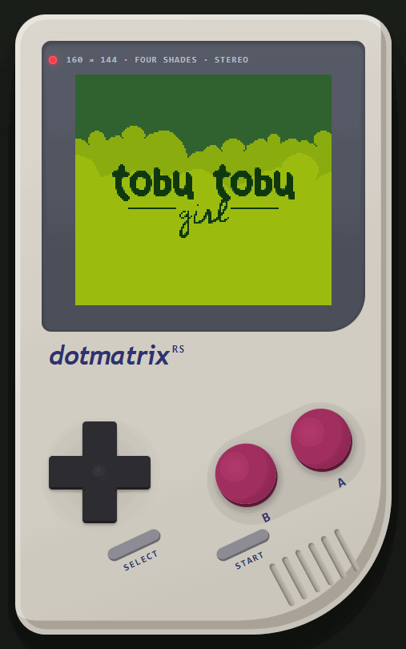
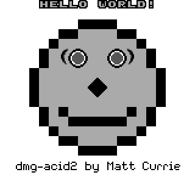
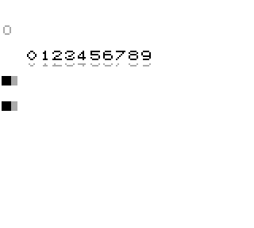
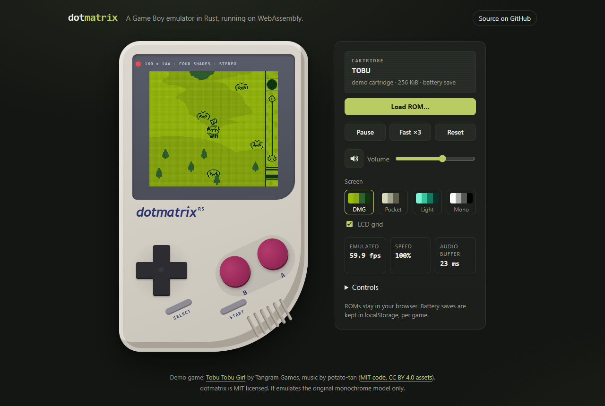
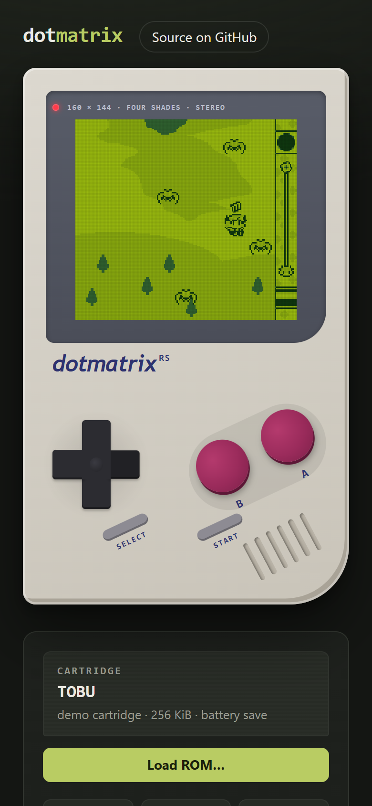
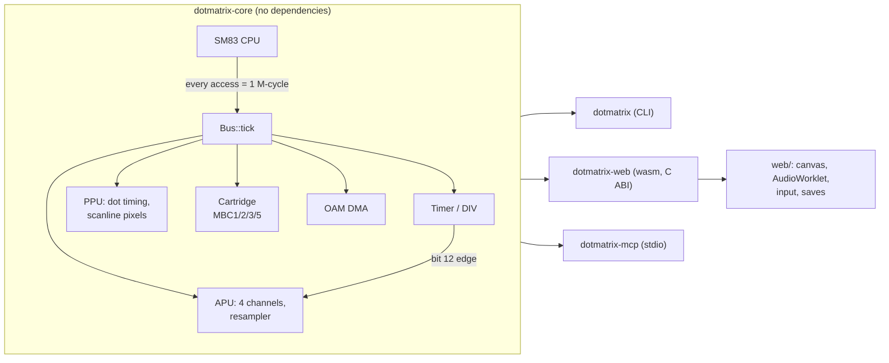

<p align="center">
  
</p>

# dotmatrix

A Game Boy (DMG) emulator written in Rust that runs natively and in the browser as a 63 KB WebAssembly module.

**[Play it in your browser](https://autumntrace.github.io/dotmatrix/)**: Tobu Tobu Girl is preloaded, or drop in your own `.gb` file.

[](https://github.com/AutumnTrace/dotmatrix/actions/workflows/ci.yml)
[](https://autumntrace.github.io/dotmatrix/)
[](LICENSE)

The core is a dependency-free crate: an SM83 CPU where timing comes from the
memory accesses themselves rather than a cycle table, a PPU that keeps dot-level
timing but draws whole scanlines, a four-channel APU, the timer with its
falling-edge glitches, and MBC1/2/3/5 cartridges. Around it sit a headless CLI,
the web frontend, and a small MCP server so a coding agent can play homebrew.

## What works

Results against the [c-sp/game-boy-test-roms](https://github.com/c-sp/game-boy-test-roms)
v7.0 bundle. Everything that passes is a regression test in `cargo test`, which CI
runs with the ROMs fetched by `scripts/fetch-test-roms.sh`; the failures listed are
from `dotmatrix check`.

| Suite | Result | Notes |
| --- | --- | --- |
| Blargg `cpu_instrs` | **11/11** + combined ROM | |
| Blargg `instr_timing` | **pass** | |
| Blargg `mem_timing` / `mem_timing-2` | **3/3** + combined, **3/3** + combined | read, write and read-modify-write land on the right M-cycle |
| Blargg `halt_bug` | **pass** | screenshot comparison |
| Blargg `dmg_sound` | **9/12** | fail: `09-wave read while on`, `10-wave trigger while on`, `12-wave write while on` |
| Blargg `oam_bug` | **3/8** | the OAM corruption bug is not emulated; `1-lcd_sync`, `3-non_causes`, `6-timing_no_bug` pass |
| [dmg-acid2](https://github.com/mattcurrie/dmg-acid2) | **pass** | pixel-exact against the DMG reference image |
| Mooneye acceptance | **66/66** for DMG A/B/C | 9 more ROMs target other models (`-dmg0`, `-mgb`, `-S`, `-sgb`, `-sgb2`) and fail as expected |
| Mooneye emulator-only (MBC1, MBC2, MBC5) | **28/28** | including the MBC1 multicart wiring |
| Mooneye `manual-only/sprite_priority` | **pass** | screenshot comparison |
| [MBC3 Tester](https://github.com/EricKirschenmann/MBC3-Tester-gb) | **pass** | all 256 banks of a 4 MiB ROM |

<details>
<summary>All 66 Mooneye acceptance tests</summary>

| Area | Tests (all passing) |
| --- | --- |
| Instruction timing | `add_sp_e_timing` `call_cc_timing` `call_cc_timing2` `call_timing` `call_timing2` `jp_cc_timing` `jp_timing` `ld_hl_sp_e_timing` `pop_timing` `push_timing` `ret_cc_timing` `ret_timing` `reti_timing` `rst_timing` `div_timing` |
| Interrupts, HALT, EI/DI | `di_timing-GS` `ei_sequence` `ei_timing` `halt_ime0_ei` `halt_ime0_nointr_timing` `halt_ime1_timing` `halt_ime1_timing2-GS` `if_ie_registers` `intr_timing` `rapid_di_ei` `reti_intr_timing` `interrupts/ie_push` |
| CPU and registers | `instr/daa` `bits/mem_oam` `bits/reg_f` `bits/unused_hwio-GS` |
| Boot state | `boot_div-dmgABCmgb` `boot_hwio-dmgABCmgb` `boot_regs-dmgABC` `serial/boot_sclk_align-dmgABCmgb` |
| OAM DMA | `oam_dma/basic` `oam_dma/reg_read` `oam_dma/sources-GS` `oam_dma_restart` `oam_dma_start` `oam_dma_timing` |
| PPU | `hblank_ly_scx_timing-GS` `intr_1_2_timing-GS` `intr_2_0_timing` `intr_2_mode0_timing` `intr_2_mode0_timing_sprites` `intr_2_mode3_timing` `intr_2_oam_ok_timing` `lcdon_timing-GS` `lcdon_write_timing-GS` `stat_irq_blocking` `stat_lyc_onoff` `vblank_stat_intr-GS` |
| Timer | `div_write` `rapid_toggle` `tim00` `tim00_div_trigger` `tim01` `tim01_div_trigger` `tim10` `tim10_div_trigger` `tim11` `tim11_div_trigger` `tima_reload` `tima_write_reloading` `tma_write_reloading` |

Not applicable to a DMG A/B/C and failing as they should: `boot_div-S`,
`boot_div-dmg0`, `boot_div2-S`, `boot_hwio-S`, `boot_hwio-dmg0`,
`boot_regs-dmg0`, `boot_regs-mgb`, `boot_regs-sgb`, `boot_regs-sgb2`.
</details>

<p>
  
  
</p>

Run the same checks yourself on any folder of test ROMs:

```console
$ ./scripts/fetch-test-roms.sh
$ cargo run --release -p dotmatrix-cli -- check test-roms/mooneye-test-suite/acceptance/timer
test-roms/mooneye-test-suite/acceptance/timer\div_write.gb   PASS
test-roms/mooneye-test-suite/acceptance/timer\rapid_toggle.gb PASS
...
13 passed, 0 failed
```

## Controls

| Game Boy | Keyboard | Gamepad |
| --- | --- | --- |
| D-pad | arrow keys | d-pad or left stick |
| A / B | `X` / `Z` (or `S` / `A`) | right / bottom face button |
| Start / Select | `Enter` / `Shift` | Start / Back |
| Fast forward (x3) | hold `Space` | right bumper or trigger |
| Pause, mute | `P`, `M` | |

On a phone the console itself is the controller: the d-pad tracks your thumb
(diagonals included) and every button is multi-touch. Battery saves go to
`localStorage` per ROM, and ROMs you load never leave the browser.

<p>
  
  
</p>

## How it is put together



The CPU never looks up how long an instruction takes. Each memory access
advances the whole machine by one M-cycle before it happens, and internal
delays tick explicitly, so both the length of an instruction and the cycle on
which each of its reads and writes lands come from the instruction body. The
PPU tracks modes, LY and the STAT line per dot (with a fast path that skips
quiet stretches), but produces pixels a scanline at a time. More detail in
[docs/architecture.md](docs/architecture.md).

## Things that were tricky

- **Fifteen Mooneye tests failing for one reason.** All the `*_timing` tests
  for CALL/RET/PUSH/JP use OAM DMA as a stopwatch. OAM was unlocking in the
  same M-cycle as the last DMA copy instead of the one after.
- **Where interrupts are sampled.** `rapid_toggle` was off by one loop
  iteration until interrupts were checked during the next opcode fetch rather
  than before it, which in turn only worked once HALT was modelled as that
  fetch repeating.
- **Pan Docs vs. the STAT interrupt** on object penalties in mode 3: matching
  all of `intr_2_mode0_timing_sprites` took a careful look at floor vs. ceiling
  rounding over its 105 cases.
- **Reads and writes lock out at different times.** `lcdon_write_timing` shows
  OAM writes landing in the last cycle of OAM scan, where reads already fail.

The full story, with the dead ends, is in [docs/devlog.md](docs/devlog.md).

## Performance

Measured on a Ryzen 7 9800X3D under Windows 11, Rust 1.100.0 release build
(fat LTO, one codegen unit). "Real time" is the DMG's 59.73 frames per second.

| Build | Workload | Frames/s | Real time |
| --- | --- | ---: | ---: |
| Native CLI | Tobu Tobu Girl, 6000 frames (title, menus, play) | 3,977 | 66.6x |
| Native CLI | Blargg `cpu_instrs`, 3300 frames | 4,077 | 68.3x |
| Native CLI | dmg-acid2, 6000 frames | 5,409 | 90.6x |
| wasm in Chrome 157 (headless) | Tobu Tobu Girl, same input script | 2,535 | 42.4x |

Native numbers are the best of three runs of
`dotmatrix run <rom> --frames N --bench` (see the commands below). The wasm
number is `node scripts/bench-wasm.mjs`, which calls `dm_run_frame` in a tight
loop inside the page (best of three), including the RGBA conversion but not
canvas drawing. The wasm module is 63,164 bytes and imports nothing. On a
desktop with other things open there is run-to-run noise: across six native
runs of this build, Tobu Tobu Girl ranged from 3,828 to 4,201 frames/s, and
across four runs in Chrome from 2,475 to 2,593.

```sh
cargo build --release
./target/release/dotmatrix run web/roms/tobutobugirl.gb --frames 6000 --bench \
  --press start@450 --press start@700 --press start@1100 --press start@1300 --press a@1500
```

## Letting an agent play (MCP)

`dotmatrix-mcp` is a stdio [Model Context Protocol](https://modelcontextprotocol.io)
server with five tools: `load_rom`, `press_buttons` (buttons plus hold
frames), `run_frames`, `screenshot` (PNG image content) and `read_memory`.
It speaks both the current 2026-07-28 revision (`server/discover`,
per-request versions) and the older `initialize` handshake, so it works with
today's clients. JSON-RPC is hand-rolled on `serde_json`.

```sh
cargo build --release -p dotmatrix-mcp
```

```json
{
  "mcpServers": {
    "dotmatrix": { "command": "/path/to/dotmatrix/target/release/dotmatrix-mcp" }
  }
}
```

Then ask your agent something like "load web/roms/tobutobugirl.gb and get past
the title screen". `crates/mcp/tests/stdio.rs` drives the real binary over
stdio and plays a few seconds of the demo cartridge.

## Building from source

You need a stable Rust toolchain (1.85 or newer for edition 2024).

```sh
cargo test                                  # unit tests; ROM suites skip themselves
./scripts/fetch-test-roms.sh                # downloads the test ROM bundle into test-roms/
cargo test --workspace                      # now with Blargg, Mooneye, acid2 and friends

cargo run --release -p dotmatrix-cli -- run game.gb --frames 600 --screenshot shot.png --scale 3 --palette green
cargo run --release -p dotmatrix-cli -- run cpu_instrs.gb --frames 3300 --serial   # Blargg prints over serial
cargo run --release -p dotmatrix-cli -- run game.gb --frames 1800 --wav out.wav --save game.sav
```

The web build needs the `wasm32-unknown-unknown` target and nothing else:

```sh
rustup target add wasm32-unknown-unknown
./scripts/build-web.sh                      # builds and copies web/dotmatrix.wasm
node scripts/serve.mjs                      # or any static file server on web/
```

`npm ci` installs Playwright and two small helpers for `npm run smoke` (a
headless browser check that CI also runs) and `npm run media`, which records
the GIF and screenshots in this README.

## Roadmap and known gaps

- **Pixels are drawn per scanline.** Mode 3 timing is accurate, but mid-line
  register writes (the Mealybug tests, some demo effects) are not visible.
  A pixel FIFO would fix that.
- **OAM corruption bug** (`oam_bug` 2, 4, 5, 7, 8) is not emulated.
- **Wave RAM access while channel 3 plays** follows a simplified rule, hence
  the three `dmg_sound` failures.
- **MBC3 real-time clock** counts emulated time only. It is not saved with
  battery RAM and does not catch up with wall-clock time between sessions.
- **No boot ROM**: the machine starts in the DMG's post-boot state. `STOP` is
  a low-power wait for a button press with DIV reset, not a model of the
  stopped oscillator.
- **No save states, no link cable** (serial transfers receive `0xFF`), and no
  Game Boy Color mode. CGB-only cartridges are refused with a clear message.

## Credits and references

- [Pan Docs](https://gbdev.io/pandocs/) and the [gbdev](https://gbdev.io) community.
- [Mooneye Test Suite](https://github.com/Gekkio/mooneye-test-suite) by Joonas Javanainen: the test sources and their comments explain exactly what they expect.
- [Blargg's test ROMs](https://github.com/retrio/gb-test-roms) by Shay Green.
- [dmg-acid2](https://github.com/mattcurrie/dmg-acid2) by Matt Currie.
- [MBC3 Tester](https://github.com/EricKirschenmann/MBC3-Tester-gb) by Eric Kirschenmann.
- [c-sp/game-boy-test-roms](https://github.com/c-sp/game-boy-test-roms) for bundling all of the above with reference images and how-tos.
- **Tobu Tobu Girl** by [Tangram Games](https://tangramgames.itch.io/tobutobugirl), music by potato-tan. The
  [source](https://github.com/SimonLarsen/tobutobugirl) is MIT licensed and all assets are CC BY 4.0, so the
  ROM ships in [`web/roms/`](web/roms/) unmodified, taken from the [Homebrew Hub](https://hh.gbdev.io) database.
  See [`web/roms/tobutobugirl-LICENSE.txt`](web/roms/tobutobugirl-LICENSE.txt).
- [gifenc](https://github.com/mattdesl/gifenc) by Matt DesLauriers for the README GIF.

dotmatrix is MIT licensed. Game Boy is a trademark of Nintendo; this project is
not affiliated with or endorsed by Nintendo and ships no commercial software.
